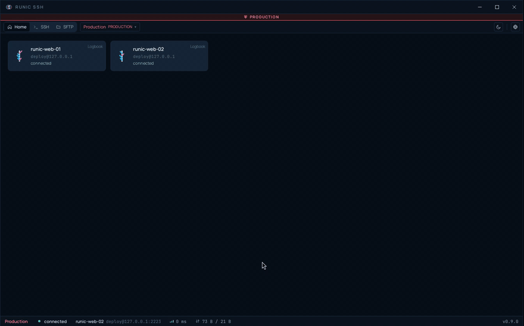

<p align="center">
  <picture>
    <source media="(prefers-color-scheme: dark)" srcset="assets/logo-dark.png">
    <source media="(prefers-color-scheme: light)" srcset="assets/logo-light.png">
    
  </picture>
</p>

<p align="center">
  <strong>An open-source SSH client for people who live in a terminal.</strong><br>
  <sub>Rust and Tauri. Small, auditable, and built to be handed over.</sub>
</p>

<p align="center">
  <!-- include_prereleases stays so a later rc is shown too. -->
  <a href="https://github.com/marciopaiva/runic-ssh/releases"></a>
  <a href="https://github.com/marciopaiva/runic-ssh/actions/workflows/gate.yml"></a>
  <a href="https://github.com/marciopaiva/runic-ssh/actions/workflows/audit.yml"></a>
  
  
</p>

## Why this exists

A sysadmin connects to a server fifty times a day, and the tools for it are
either twenty years old or expensive. The good parts of the expensive ones,
a pleasant session manager, SFTP beside the terminal, tunnels that aren't a
command-line flag, aren't hard problems. They're just behind a licence.

**Runic SSH puts those in something free, small enough to audit, and owned by
the people who use it.** Rust and Tauri 2.0, `russh` in process instead of an
OpenSSH binary, the OS keychain for secrets, and a decision record for every
architectural choice.

The name is the runic alphabets: symbols carved to write, remember, and cross
distances. A rune fits in the hand. So should the tool that carries your keys.

## What it looks like

The running application, connected to this project's own SSH fixtures. Not a
mockup, not the design canvas. A 45 second tour, in this order: the Hall of a
Production Space, the Bar scoping two hosts to run a saved macro, two sessions
side by side, Monitor, a file sent between two hosts over SFTP, and a host's
Logbook.

<picture>
  <source media="(prefers-color-scheme: dark)" srcset="assets/tour-dark.gif">
  <source media="(prefers-color-scheme: light)" srcset="assets/tour-light.gif">
  
</picture>

## What it does

- **Hosts and sessions.** A host book organized by how hosts connect, with
  bastions nesting the hosts behind them. Spaces (Production, Staging, Lab)
  group hosts, and the Bar (`Ctrl+Shift+P`, `Cmd+K` on a Mac) opens hosts,
  actions and saved macros from one field.
- **Terminals.** One per session, with a second shell on an open connection, a
  local shell with no SSH behind it, and reconnection that keeps the history.
- **SFTP beside the terminal**, from one source to up to four destinations.
- **Monitor.** CPU, memory, disk, network, processes and logs, read over the
  connection already open. No agent is installed on the host.
- **Macros**, typed into the shell or run as isolated scripts, and a saved
  script run on several hosts at once with the answers grouped. Reaching two or
  more hosts with any in production takes a press held for about 800 ms. It
  stops a slip and is not a security control.
- **Port forwarding**, local, remote and dynamic (SOCKS), saved per host.
- **A Logbook per host**, on this machine only: connections, host keys trusted
  or replaced, and macro runs. Never keystrokes, host output or passwords.
- **Host keys verified, always, and credentials kept in the OS keychain**,
  resolved at the moment of use and never shown to the interface
  ([security model](docs/security-model.md)).
- **Light and dark; English, Brazilian Portuguese and Spanish.**

Every choice behind these has a [decision record](docs/adr/). What a release
does not do yet is in [`CHANGELOG.md`](CHANGELOG.md), under *Known limitations*,
on purpose. Importing sessions from OpenSSH and PuTTY was considered and
dropped ([#128](https://github.com/marciopaiva/runic-ssh/issues/128)).

## Downloads

Installers for Windows, macOS (Apple Silicon) and Linux are attached to each
[release](https://github.com/marciopaiva/runic-ssh/releases), with a
`SHA256SUMS` covering every file. Currently
[v1.0.0](https://github.com/marciopaiva/runic-ssh/releases/tag/v1.0.0):

| Platform | Recommended | Also |
| --- | --- | --- |
| **Windows**, x64 | [Installer `.exe`](https://github.com/marciopaiva/runic-ssh/releases/download/v1.0.0/Runic-SSH_1.0.0_x64-setup.exe) | [`.msi`](https://github.com/marciopaiva/runic-ssh/releases/download/v1.0.0/Runic-SSH_1.0.0_x64_en-US.msi) |
| **macOS**, Apple Silicon | [Disk image `.dmg`](https://github.com/marciopaiva/runic-ssh/releases/download/v1.0.0/Runic-SSH_1.0.0_aarch64.dmg) | |
| **Linux**, x86-64 | [`.deb`](https://github.com/marciopaiva/runic-ssh/releases/download/v1.0.0/Runic-SSH_1.0.0_amd64.deb) for Debian and Ubuntu | [`.rpm`](https://github.com/marciopaiva/runic-ssh/releases/download/v1.0.0/Runic-SSH-1.0.0-1.x86_64.rpm) for Fedora, [`.AppImage`](https://github.com/marciopaiva/runic-ssh/releases/download/v1.0.0/Runic-SSH_1.0.0_amd64.AppImage) for the rest |

**Nothing is code-signed.** Windows shows SmartScreen and macOS says the
application is damaged; both are what an operating system says about a binary
whose author it cannot verify. [`docs/installing.md`](docs/installing.md) has
the exact commands per platform and tracks **which packages a person has
actually run**, which is a shorter list than the one the build produces. macOS
is not on it yet.

```sh
sha256sum -c SHA256SUMS --ignore-missing   # before installing anything
gh attestation verify <file> --repo marciopaiva/runic-ssh   # which run built it (gh 2.49 or later)
```

## Building it

`pnpm install`, then `pnpm tauri dev` to run it and `pnpm tauri build` to
package it. Rust installs itself from `rust-toolchain.toml`; Node 22 and pnpm
via `corepack enable`; Linux also needs the WebKitGTK stack.
[`docs/building.md`](docs/building.md) has the per-platform prerequisites and
the traps, and `pnpm gate` runs the five checks CI runs.

## Documentation

- [Changelog](CHANGELOG.md): what changed, and what each release does not do yet
- [Installing](docs/installing.md): the unsigned-binary warnings per platform, and which packages a person has actually run
- [Building](docs/building.md): prerequisites and the gate
- [Testing](docs/testing.md): the SSH fixtures, and how every feature was driven against them
- [Architecture](docs/architecture.md): how the Rust core and the webview fit together
- [Security model](docs/security-model.md): threat model and the rules that follow from it
- [Decision records](docs/adr/): why the stack looks the way it does, reversals included
- [CLAUDE.md](CLAUDE.md): the working agreement, for contributors and AI assistants alike

## Contributing

The repository assumes whoever writes the next change did not write the last
one: every decision has a record, the process is written down, and the
repetitive workflows are encoded in `.claude/skills/` as plain markdown. This
project is built with AI assistance and says so here rather than in its commit
messages, where [CLAUDE.md](CLAUDE.md) forbids it: what matters in a history
is what changed and why, not what typed it.

Branch as `feat/<slug>` or `fix/<slug>`, write the test with the code, run the
gate, commit conventionally, one logical change per commit. Anything touching
credentials, host key verification, logging or the Tauri capability set needs
a decision record before the code. [CLAUDE.md](CLAUDE.md) is the contract;
read it before the code.

## Security

Found a vulnerability? Please report it privately, not in a public issue: see
[`SECURITY.md`](SECURITY.md). What the project promises and what it accepts by
design is in [`docs/security-model.md`](docs/security-model.md).

## License

Distributed under the **MIT** license. See `LICENSE`. Bundled typefaces
(Manrope, JetBrains Mono) ship under the SIL Open Font License 1.1; see
[`src/styles/fonts/`](src/styles/fonts/). The licence text of every dependency
is in [`THIRD-PARTY-LICENSES.html`](THIRD-PARTY-LICENSES.html) (Rust) and
[`THIRD-PARTY-NOTICES.md`](THIRD-PARTY-NOTICES.md) (npm and fonts), and both
travel inside each installer.

---
*Made with ❤️ and Rust.*
